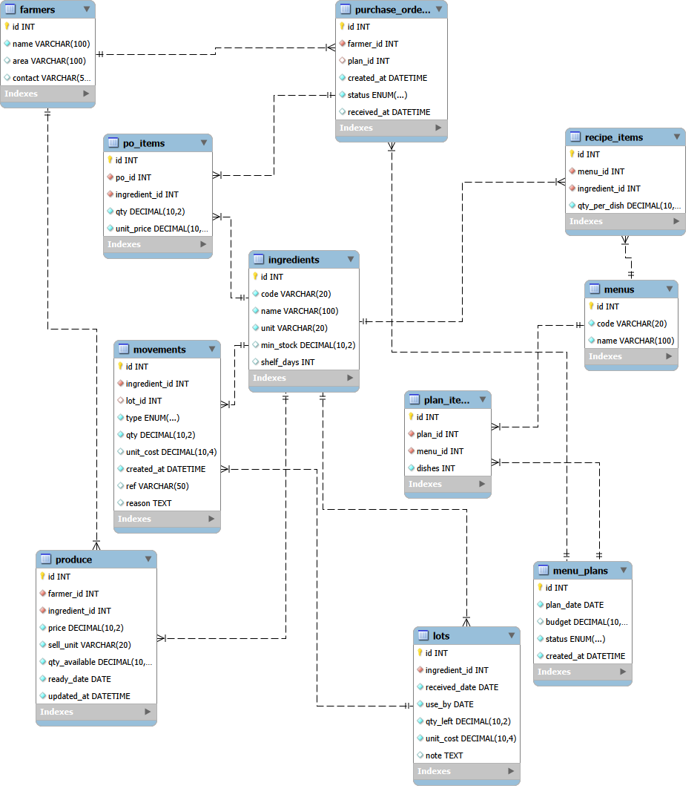

# คู่มือฐานข้อมูลและ SQL — Community Menu Planner

เอกสารนี้อธิบายว่าส่วนต่าง ๆ ของระบบเชื่อมกันผ่าน MySQL อย่างไร ครอบคลุมตาราง Primary Key, Foreign Key, การไหลของข้อมูล, transaction, query สำคัญ และไฟล์ SQL ในโครงการ

## 1. ภาพ ER Diagram



ภาพแสดง 11 ตารางหลักและเส้นความสัมพันธ์แบบ one-to-many ตัวอย่างเช่นวัตถุดิบหนึ่งรายการมีได้หลายล็อต และคำสั่งซื้อหนึ่งใบมีได้หลายรายการ

สัญลักษณ์ที่ควรอ่าน:

- รูปกุญแจสีเหลืองคือ Primary Key
- คอลัมน์ที่เป็น Foreign Key ชี้ไป Primary Key ของอีกตาราง
- ด้านขีดเดี่ยวคือข้อมูลฝั่ง “หนึ่ง”
- ด้านขาแฉกคือข้อมูลฝั่ง “หลาย”
- เส้นประในภาพเป็น non-identifying relationship หมายถึงลูกมี Primary Key ของตัวเอง และเก็บ ID ของแม่เป็น Foreign Key

## 2. ไฟล์ฐานข้อมูลแต่ละไฟล์ใช้ทำอะไร

### `setup_database.sql`

ใช้สำหรับติดตั้งปกติ ทำเพียง:

1. สร้าง database `community_menu`
2. สร้างหรือปรับรหัสผู้ใช้ `menu_user@localhost`
3. ให้สิทธิ์ผู้ใช้นี้กับ `community_menu.*`

ไฟล์นี้ไม่สร้างตารางและไม่ใส่ข้อมูล ตารางจะถูกสร้างโดย `db.py` ตอนเปิดโปรแกรมครั้งแรก

### `db.py`

`DDL_STATEMENTS` ในไฟล์นี้คือสคีมาที่ runtime ใช้จริงสำหรับการติดตั้งใหม่ `create_tables()` รัน `CREATE TABLE IF NOT EXISTS` และ `seed_demo_data()` ใส่ข้อมูลจำลองเมื่อ `ingredients` ว่าง

### `community_menu_mysql.sql`

เป็น full export/snapshot ที่รวมการสร้าง database ตาราง ข้อมูลตัวอย่าง view, stored procedure และ index เหมาะสำหรับอ่านโครงสร้าง อ้างอิง หรือย้าย snapshot ไม่ใช่ไฟล์หลักสำหรับติดตั้งโปรแกรมปกติ

ไม่ควร import ไฟล์นี้ซ้ำลงฐานข้อมูลที่มีข้อมูล เพราะมี `INSERT` พร้อม ID คงที่และอาจชน Primary Key อีกทั้งวันที่ข้อมูลเป็น snapshot ไม่เลื่อนไปตามวันที่เปิดโปรแกรมเหมือน `seed_demo_data()`

### ความต่างที่ต้องทราบ

สคีมาจาก `db.py` และ full export มีรายละเอียดบางจุดต่างกัน เช่น:

| จุด | `db.py` สำหรับฐานใหม่ | full export |
|---|---|---|
| `recipe_items` | มี unique `(menu_id, ingredient_id)` | มี index แต่ snapshot นี้ไม่มี unique ดังกล่าว |
| `farmers.name` | `VARCHAR(100)` | `VARCHAR(150)` |
| `menu_plans.budget` | `DECIMAL(10,2)` | `DECIMAL(12,2)` |
| `movements.ref` | `VARCHAR(50)` | `VARCHAR(100)` |
| ID | `INT` | หลายตารางใช้ `INT UNSIGNED` |
| view/procedure/index เพิ่มเติม | ไม่สร้าง | มีใน full export |

โปรแกรมไม่ได้ทำ schema migration เพื่อปรับของเดิมให้ตรงอัตโนมัติ `CREATE TABLE IF NOT EXISTS` จะไม่แก้ตารางที่มีอยู่แล้ว ดังนั้นฐานที่สร้างใหม่ควรใช้ `setup_database.sql` แล้วให้ `db.py` สร้างตาราง

## 3. แผนที่กลุ่มข้อมูล

ตารางแบ่งเป็น 4 กลุ่ม:

| กลุ่ม | ตาราง | หน้าที่ |
|---|---|---|
| คลัง | `ingredients`, `lots`, `movements` | master วัตถุดิบ ยอดแยกล็อต และประวัติการเข้าออก |
| สูตร | `menus`, `recipe_items` | เมนูและวัตถุดิบต่อหนึ่งจาน |
| ชุมชน/จัดซื้อ | `farmers`, `produce`, `purchase_orders`, `po_items` | ผู้ขาย ข้อเสนอ ผลผลิต และคำสั่งซื้อ |
| แผน | `menu_plans`, `plan_items` | แผนเมนู จำนวนจาน และการเชื่อมแผนไป PO |

`ingredients` เป็นศูนย์กลางเพราะถูกอ้างโดยสูตร ล็อต movement ผลผลิต และรายการสั่งซื้อ ส่วน `menus` เชื่อมสูตรกับแผน และ `farmers` เชื่อมผลผลิตกับคำสั่งซื้อ

## 4. ตารางและคอลัมน์โดยละเอียด

ชนิดข้อมูลด้านล่างอิงสคีมาที่ `db.py` สร้างในการติดตั้งใหม่

### 4.1 `ingredients` — แม่ข้อมูลวัตถุดิบ

| คอลัมน์ | ชนิด | ความหมาย |
|---|---|---|
| `id` | `INT AUTO_INCREMENT` | Primary Key |
| `code` | `VARCHAR(20)` | รหัสที่ผู้ใช้เห็น, unique |
| `name` | `VARCHAR(100)` | ชื่อวัตถุดิบ |
| `unit` | `VARCHAR(20)` | หน่วยมาตรฐาน: กรัม/ฟอง/ชิ้น |
| `min_stock` | `DECIMAL(10,2)` | ยอดขั้นต่ำสำหรับเตือน |
| `shelf_days` | `INT` | อายุเก็บโดยประมาณ ใช้คำนวณ `use_by` ตอนรับ PO |

ตารางนี้ไม่เก็บยอดคงเหลือโดยตรง ยอดคงเหลือคำนวณจาก `SUM(lots.qty_left)` เพื่อไม่ให้เกิดข้อมูลซ้ำระหว่างยอดรวมกับยอดแต่ละล็อต

### 4.2 `lots` — ล็อตวัตถุดิบ

| คอลัมน์ | ชนิด | ความหมาย |
|---|---|---|
| `id` | `INT AUTO_INCREMENT` | Primary Key/เลขล็อต |
| `ingredient_id` | `INT` | FK ไป `ingredients.id` |
| `received_date` | `DATE` | วันที่รับเข้า |
| `use_by` | `DATE` | วันที่ควรใช้ก่อน |
| `qty_left` | `DECIMAL(10,2)` | จำนวนคงเหลือในหน่วยมาตรฐาน |
| `unit_cost` | `DECIMAL(10,4)` | ต้นทุนต่อหน่วยมาตรฐาน |
| `note` | `TEXT` | หมายเหตุ |

สต็อกแยกล็อตช่วยให้เลือก FEFO และคำนวณต้นทุนตามล็อตจริง `qty_left` เปลี่ยนเมื่อรับเข้า เบิก ของเสีย หรือปรับยอด

### 4.3 `movements` — สมุดประวัติสต็อก

| คอลัมน์ | ชนิด | ความหมาย |
|---|---|---|
| `id` | `INT AUTO_INCREMENT` | Primary Key |
| `ingredient_id` | `INT` | FK ไปวัตถุดิบ |
| `lot_id` | `INT NULL` | FK ไปล็อต; เป็น null ได้หากล็อตถูกลบ |
| `type` | `ENUM` | `IN`, `USE`, `WASTE`, `ADJUST` |
| `qty` | `DECIMAL(10,2)` | ปริมาณการเปลี่ยนแปลง; เข้าเป็นบวก ออกเป็นลบ |
| `unit_cost` | `DECIMAL(10,4)` | ต้นทุนต่อหน่วย ณ เวลาทำรายการ |
| `created_at` | `DATETIME` | วันเวลาเกิดรายการ |
| `ref` | `VARCHAR(50)` | แหล่งอ้างอิง เช่น เลข PO/เลขแผน |
| `reason` | `TEXT` | เหตุผลหรือคำอธิบาย |

กติกาเครื่องหมายใน application:

| ประเภท | ตัวอย่าง `qty` | ผลต่อ `lots.qty_left` |
|---|---:|---:|
| `IN` | `+1000` | เพิ่ม 1000 |
| `USE` | `-300` | ลด 300 |
| `WASTE` | `-50` | ลด 50 |
| `ADJUST` | `+20` หรือ `-20` | ตั้งยอดใหม่ แล้วเก็บส่วนต่าง |

`movements` เป็น audit trail แต่โค้ดไม่ได้คำนวณยอดคงเหลือโดย replay movement ทุกครั้ง ยอดปัจจุบันอ่านจาก `lots.qty_left`

### 4.4 `menus` — แม่ข้อมูลเมนู

| คอลัมน์ | ชนิด | ความหมาย |
|---|---|---|
| `id` | `INT AUTO_INCREMENT` | Primary Key |
| `code` | `VARCHAR(20)` | รหัสเมนู unique และเป็นรหัสที่ AI ต้องตอบ |
| `name` | `VARCHAR(100)` | ชื่อเมนู |

### 4.5 `recipe_items` — สูตรต่อหนึ่งจาน

| คอลัมน์ | ชนิด | ความหมาย |
|---|---|---|
| `id` | `INT AUTO_INCREMENT` | Primary Key |
| `menu_id` | `INT` | FK ไป `menus.id` |
| `ingredient_id` | `INT` | FK ไป `ingredients.id` |
| `qty_per_dish` | `DECIMAL(10,2)` | ปริมาณต่อจานในหน่วยมาตรฐาน |

ความสัมพันธ์นี้ทำให้ `menus` กับ `ingredients` เป็น many-to-many ผ่าน `recipe_items`: เมนูหนึ่งมีหลายวัตถุดิบ และวัตถุดิบหนึ่งอยู่ในหลายเมนู

### 4.6 `farmers` — เกษตรกร/ผู้ขาย

| คอลัมน์ | ชนิด | ความหมาย |
|---|---|---|
| `id` | `INT AUTO_INCREMENT` | Primary Key |
| `name` | `VARCHAR(100)` | ชื่อบุคคล กลุ่ม หรือฟาร์ม |
| `area` | `VARCHAR(100)` | พื้นที่ |
| `contact` | `VARCHAR(50)` | ช่องทางติดต่อ |

### 4.7 `produce` — ผลผลิตพร้อมขาย

| คอลัมน์ | ชนิด | ความหมาย |
|---|---|---|
| `id` | `INT AUTO_INCREMENT` | Primary Key |
| `farmer_id` | `INT` | FK ไปผู้ขาย |
| `ingredient_id` | `INT` | FK ไปวัตถุดิบ |
| `price` | `DECIMAL(10,2)` | ราคาต่อ `sell_unit` |
| `sell_unit` | `VARCHAR(20)` | หน่วยขาย เช่น กก./กรัม/ฟอง/ชิ้น |
| `qty_available` | `DECIMAL(10,2)` | จำนวนที่พร้อมขายใน `sell_unit` |
| `ready_date` | `DATE` | วันที่พร้อมส่ง |
| `updated_at` | `DATETIME` | เวลาอัปเดตราคา/จำนวนล่าสุด |

ระบบแปลง `price` และ `qty_available` เป็นหน่วยมาตรฐานก่อนเปรียบเทียบ เช่น 30 บาท/กก. เท่ากับ 0.03 บาท/กรัม

### 4.8 `menu_plans` — หัวแผนเมนู

| คอลัมน์ | ชนิด | ความหมาย |
|---|---|---|
| `id` | `INT AUTO_INCREMENT` | Primary Key/เลขแผน |
| `plan_date` | `DATE` | วันที่สร้างแผน |
| `budget` | `DECIMAL(10,2)` | งบซื้อเพิ่มที่ผู้ใช้กรอก |
| `status` | `ENUM` | `DRAFT`, `CONFIRMED`, `USED` |
| `created_at` | `DATETIME` | เวลาสร้าง |

โค้ดปัจจุบันสร้างแผนเป็น `CONFIRMED` โดยตรง และเปลี่ยนเป็น `USED` หลังเบิกสำเร็จ ค่า `DRAFT` มีในสคีมาแต่หน้าจอยังไม่ใช้

### 4.9 `plan_items` — เมนูในแผน

| คอลัมน์ | ชนิด | ความหมาย |
|---|---|---|
| `id` | `INT AUTO_INCREMENT` | Primary Key |
| `plan_id` | `INT` | FK ไป `menu_plans.id` |
| `menu_id` | `INT` | FK ไป `menus.id` |
| `dishes` | `INT` | จำนวนจานของเมนูนั้น |

ตารางนี้ทำให้แผนหนึ่งมีหลายเมนู และเมนูเดิมอยู่ในหลายแผนได้

### 4.10 `purchase_orders` — หัวคำสั่งซื้อ

| คอลัมน์ | ชนิด | ความหมาย |
|---|---|---|
| `id` | `INT AUTO_INCREMENT` | Primary Key/เลข PO |
| `farmer_id` | `INT` | FK ไปผู้ขาย |
| `plan_id` | `INT NULL` | FK ไปแผน; null สำหรับ PO ที่สร้างเอง |
| `created_at` | `DATETIME` | เวลาสั่ง |
| `status` | `ENUM` | `PENDING`, `RECEIVED`, `CANCELLED` |
| `received_at` | `DATETIME NULL` | เวลารับสำเร็จ |

หนึ่ง PO เป็นของผู้ขายหนึ่งราย แต่แผนหนึ่งสร้างหลาย PO ได้เมื่อซื้อจากหลายเกษตรกร

### 4.11 `po_items` — รายการในคำสั่งซื้อ

| คอลัมน์ | ชนิด | ความหมาย |
|---|---|---|
| `id` | `INT AUTO_INCREMENT` | Primary Key |
| `po_id` | `INT` | FK ไป `purchase_orders.id` |
| `ingredient_id` | `INT` | FK ไปวัตถุดิบ |
| `qty` | `DECIMAL(10,2)` | จำนวนในหน่วยมาตรฐาน |
| `unit_price` | `DECIMAL(10,4)` | ราคาต่อหน่วยมาตรฐาน |

ยอดใบสั่งซื้อคำนวณด้วย `SUM(qty * unit_price)` ไม่เก็บ total ซ้ำในหัว PO

## 5. ความสัมพันธ์และกฎเมื่อลบข้อมูล

| ตารางแม่ → ตารางลูก | Cardinality | Foreign Key | ON DELETE | เหตุผล |
|---|---|---|---|---|
| `ingredients` → `lots` | 1:N | `lots.ingredient_id` | `RESTRICT` | ห้ามลบวัตถุดิบที่ยังมีล็อต |
| `ingredients` → `movements` | 1:N | `movements.ingredient_id` | `RESTRICT` | รักษาประวัติของวัตถุดิบ |
| `lots` → `movements` | 1:N | `movements.lot_id` | `SET NULL` | ถ้าล็อตหาย ประวัติยังอยู่ |
| `menus` → `recipe_items` | 1:N | `recipe_items.menu_id` | `CASCADE` | ลบเมนูแล้วลบสูตรของเมนูนั้น |
| `ingredients` → `recipe_items` | 1:N | `recipe_items.ingredient_id` | `RESTRICT` | ห้ามลบวัตถุดิบที่สูตรใช้อยู่ |
| `farmers` → `produce` | 1:N | `produce.farmer_id` | `CASCADE` | ลบผู้ขายแล้วลบข้อเสนอของรายนั้น |
| `ingredients` → `produce` | 1:N | `produce.ingredient_id` | `RESTRICT` | ห้ามลบวัตถุดิบที่มีข้อเสนอ |
| `menu_plans` → `plan_items` | 1:N | `plan_items.plan_id` | `CASCADE` | ลบแผนแล้วลบรายการในแผน |
| `menus` → `plan_items` | 1:N | `plan_items.menu_id` | `RESTRICT` | รักษาแผนเก่าที่อ้างเมนู |
| `farmers` → `purchase_orders` | 1:N | `purchase_orders.farmer_id` | `RESTRICT` | รักษาประวัติ PO ของผู้ขาย |
| `menu_plans` → `purchase_orders` | 1:N | `purchase_orders.plan_id` | `SET NULL` | PO ยังอยู่ได้แม้แผนถูกลบ |
| `purchase_orders` → `po_items` | 1:N | `po_items.po_id` | `CASCADE` | ลบหัว PO แล้วลบรายการลูก |
| `ingredients` → `po_items` | 1:N | `po_items.ingredient_id` | `RESTRICT` | รักษาประวัติรายการซื้อ |

ความหมายของ action:

- `RESTRICT`: ปฏิเสธการลบแม่ถ้ายังมีลูก
- `CASCADE`: ลบลูกตามแม่ เหมาะกับแถวที่ไม่มีความหมายเมื่อไม่มีหัว
- `SET NULL`: เก็บแถวลูกไว้แต่ตัดการอ้างอิง เหมาะกับประวัติ

## 6. การเชื่อมข้อมูลในกระบวนการจริง

### 6.1 สูตร → คำนวณความต้องการ

```text
menus
  └─ recipe_items ── ingredients
         qty_per_dish × plan_items.dishes
```

SQL แนวเดียวกับที่ระบบใช้:

```sql
SELECT r.ingredient_id,
       r.qty_per_dish * pi.dishes AS required_qty
FROM plan_items pi
JOIN recipe_items r ON r.menu_id = pi.menu_id
WHERE pi.plan_id = ?;
```

โค้ดรวม `required_qty` ของ `ingredient_id` เดียวกันอีกชั้นใน Python

### 6.2 วัตถุดิบ → สต็อกที่ใช้ได้

```sql
SELECT COALESCE(SUM(qty_left), 0) AS usable_qty
FROM lots
WHERE ingredient_id = ?
  AND qty_left > 0
  AND use_by >= CURRENT_DATE;
```

การเบิกจริงอ่านล็อตด้วย `ORDER BY use_by, id` แล้วอัปเดตทีละล็อต

### 6.3 วัตถุดิบ → ข้อเสนอเกษตรกร

```text
ingredients
  └─ produce ── farmers
```

```sql
SELECT p.*, f.name, i.unit AS std_unit
FROM produce p
JOIN farmers f ON f.id = p.farmer_id
JOIN ingredients i ON i.id = p.ingredient_id
WHERE p.ingredient_id = ?
  AND p.qty_available > 0
  AND p.ready_date <= CURRENT_DATE;
```

การเปรียบเทียบราคาต่อหน่วยมาตรฐานทำใน `logic.best_offer()` เพราะต้องใช้กฎแปลงกรัม/กิโลกรัม

### 6.4 แผน → คำสั่งซื้อ

```text
menu_plans ── plan_items ── menus
     │
     └─ purchase_orders ── po_items ── ingredients
                │
                └─ farmers
```

หลัง `calc_plan()` โค้ดจัดกลุ่มรายการที่ต้องซื้อด้วย `farmer_id` หนึ่งกลุ่มกลายเป็นหนึ่ง `purchase_orders` และหลาย `po_items`

### 6.5 รับ PO → ล็อตและ movement

```text
purchase_orders(PENDING)
  └─ po_items
       ├─ INSERT lots
       ├─ INSERT movements(IN)
       └─ UPDATE produce.qty_available
  └─ UPDATE purchase_orders(RECEIVED)
```

ทุกขั้นอยู่ใน transaction เดียว หาก insert ล็อตรายการใดล้ม ระบบ rollback ล็อตก่อนหน้า movement การลด produce และสถานะ PO ทั้งหมด

### 6.6 เบิกแผน → ลดล็อต

```text
menu_plans + plan_items + recipe_items
  → รวมความต้องการต่อ ingredient
  → เลือก lots แบบ FEFO
  → UPDATE lots.qty_left
  → INSERT movements(USE)
  → UPDATE menu_plans.status = USED
```

หากวัตถุดิบรายการท้ายไม่พอ transaction จะ rollback การลดล็อตรายการก่อนหน้าด้วย

## 7. ตัวอย่าง transaction ของการตัดสต็อก

แนวคิด SQL ของการเบิกหนึ่งล็อตเป็นดังนี้:

```sql
START TRANSACTION;

UPDATE lots
SET qty_left = qty_left - 300
WHERE id = 12;

INSERT INTO movements
    (ingredient_id, lot_id, type, qty, unit_cost, created_at, ref, reason)
VALUES
    (7, 12, 'USE', -300, 0.1400, NOW(), 'แผนเมนู #5', '');

COMMIT;
```

ในโปรแกรมจริงจำนวนและ ID ส่งผ่าน parameter binding ไม่ต่อ string จาก input ผู้ใช้ และถ้ามีหลายล็อตหรือหลายวัตถุดิบจะ commit ครั้งเดียวหลังทำครบ

## 8. สถานะของข้อมูล

### แผนเมนู

```text
DRAFT       มีใน ENUM แต่ UI ปัจจุบันยังไม่สร้าง
CONFIRMED   ยืนยันแล้ว รอเบิก
USED        เบิกวัตถุดิบแล้ว
```

### คำสั่งซื้อ

```text
PENDING     สร้างแล้ว รอรับหรือยกเลิก
RECEIVED    รับเข้าคลังแล้ว; received_at ต้องมีค่า
CANCELLED   ยกเลิกแล้ว; ห้ามรับสินค้า
```

โค้ดตรวจสถานะก่อนแก้ข้อมูลเพื่อป้องกันการกดซ้ำ แต่สคีมายังไม่มี `CHECK` บังคับคู่สถานะ/เวลา เช่น MySQL ไม่ได้บังคับเองว่า `RECEIVED` ต้องมี `received_at`

## 9. View, procedure และ trigger ใน full export

`community_menu_mysql.sql` มี view สำหรับอ้างอิง:

- `v_current_stock` — สรุปยอดและสถานะขั้นต่ำ
- `v_expiring_lots` — ล็อตภายใน 3 วัน
- `v_recipe_cost` — ประมาณต้นทุนต่อจานด้วยค่าเฉลี่ยต้นทุนล็อต

มี stored procedure:

- `sp_get_low_stock()`
- `sp_get_expiring_lots(p_days)`
- `sp_record_movement(...)`

application ปัจจุบันไม่ได้เรียก view หรือ procedure เหล่านี้ แต่ใช้ query ใน `logic.py` โดยตรง โดยเฉพาะ `sp_record_movement` มี convention ของจำนวนต่างจาก application และอัปเดตล็อตเอง จึงไม่ควรนำมาเรียกปนกับ `logic.issue()` หรือ `receive_lot()` โดยไม่ปรับแบบให้ตรงกัน

ไฟล์ export สั่ง `DROP TRIGGER IF EXISTS trg_movement_after_insert` และ `db.init_db()` ทำซ้ำทุกครั้งที่เปิดโปรแกรม เพราะ trigger รุ่นเก่าเคยอัปเดต `qty_left` หลัง insert movement ทำให้ logic อัปเดตครั้งหนึ่งและ trigger อัปเดตซ้ำอีกครั้ง

กฎปัจจุบันคือ `logic.py` เป็นเจ้าของการอัปเดตล็อตและ movement ภายใน transaction เดียว ไม่ใช้ trigger ปรับสต็อก

## 10. Index และประสิทธิภาพ

Primary Key และ Unique Key มี index อัตโนมัติ MySQL ยังต้องมี index สำหรับ Foreign Key ส่วน full export เพิ่ม index ตามรูปแบบ query เช่น:

- `movements(ingredient_id, created_at)`
- `lots(ingredient_id, qty_left)`
- `produce(ingredient_id, ready_date)`

สำหรับข้อมูลสาธิตขนาดเล็กผลต่างไม่ชัด แต่เมื่อข้อมูลโต query ที่ใช้บ่อยควรมี composite index ที่ตรงลำดับเงื่อนไข เช่น:

```sql
CREATE INDEX idx_lots_fefo
ON lots (ingredient_id, use_by, qty_left);

CREATE INDEX idx_po_status_received
ON purchase_orders (status, received_at);
```

ก่อนเพิ่ม index ใน production ควรใช้ `EXPLAIN` ตรวจ query จริง เพราะ index มากเกินไปทำให้ insert/update ช้าลงและใช้พื้นที่เพิ่ม

## 11. Query สำหรับตรวจสอบระบบ

### ยอดคงเหลือทุกวัตถุดิบ

```sql
SELECT i.code, i.name, i.unit,
       COALESCE(SUM(CASE WHEN l.qty_left > 0 THEN l.qty_left ELSE 0 END), 0) AS physical_stock,
       COALESCE(SUM(CASE WHEN l.qty_left > 0 AND l.use_by >= CURRENT_DATE
                         THEN l.qty_left ELSE 0 END), 0) AS usable_stock
FROM ingredients i
LEFT JOIN lots l ON l.ingredient_id = i.id
GROUP BY i.id, i.code, i.name, i.unit
ORDER BY i.code;
```

### ตรวจล็อตกับผลรวม movement

movement เป็นประวัติการเปลี่ยนแปลง ส่วน `qty_left` คือยอดปัจจุบัน:

```sql
SELECT l.id, i.name, l.qty_left,
       COALESCE(SUM(m.qty), 0) AS movement_balance
FROM lots l
JOIN ingredients i ON i.id = l.ingredient_id
LEFT JOIN movements m ON m.lot_id = l.id
GROUP BY l.id, i.name, l.qty_left
HAVING ABS(l.qty_left - movement_balance) > 0.001;
```

หากล็อตเริ่มต้นและทุกการแก้ผ่าน application ค่าโดยทั่วไปควรตรงกัน ความต่างอาจมาจากข้อมูลนำเข้าเก่า การแก้ SQL ตรง หรือ trigger เก่า

### PO รอรับพร้อมยอดรวม

```sql
SELECT po.id, f.name AS farmer, po.created_at,
       SUM(it.qty * it.unit_price) AS total
FROM purchase_orders po
JOIN farmers f ON f.id = po.farmer_id
JOIN po_items it ON it.po_id = po.id
WHERE po.status = 'PENDING'
GROUP BY po.id, f.name, po.created_at
ORDER BY po.id DESC;
```

### วัตถุดิบของแผนหนึ่ง

```sql
SELECT i.name, i.unit,
       SUM(ri.qty_per_dish * pi.dishes) AS required_qty
FROM plan_items pi
JOIN recipe_items ri ON ri.menu_id = pi.menu_id
JOIN ingredients i ON i.id = ri.ingredient_id
WHERE pi.plan_id = 1
GROUP BY i.id, i.name, i.unit
ORDER BY i.name;
```

## 12. Parameter binding และความปลอดภัย SQL

โค้ดส่งค่าด้วย placeholder เช่น:

```python
conn.execute(
    "SELECT * FROM lots WHERE ingredient_id=? AND use_by>=?",
    (ing_id, today_str()),
)
```

`mysql_compat.bind_sql()` แปลงเป็น `%s` แล้วให้ MySQL Connector bind ค่า จึงไม่ควรเปลี่ยนเป็น f-string หรือ string concatenation สำหรับ input ผู้ใช้

ชื่อ table/column ไม่สามารถ bind เป็น parameter ได้ หากอนาคตต้องสร้าง query แบบ dynamic ต้องเลือกชื่อจาก allowlist ที่โค้ดกำหนดเท่านั้น

ผู้ใช้ `menu_user` ในตัวอย่างได้รับสิทธิ์ทั้งหมดบน database เพื่อความสะดวกในการสาธิต สำหรับ production ควร:

- ใช้รหัสผ่านแข็งแรงและไม่ commit ลง GitHub
- จำกัด host แทน `%`
- ให้สิทธิ์เท่าที่จำเป็น
- แยกบัญชี migration ออกจากบัญชี runtime
- เปิด TLS เมื่อฐานข้อมูลไม่ได้อยู่เครื่องเดียวกัน
- สำรองข้อมูลและทดสอบกู้คืนเป็นประจำ

## 13. การสำรองและย้ายข้อมูล

สำรองทั้งสคีมาและข้อมูล:

```powershell
mysqldump -u menu_user -p --single-transaction --routines community_menu > community_menu_backup.sql
```

กู้คืนควรทำในฐานที่ว่างและปิด application ก่อน:

```powershell
mysql -u menu_user -p community_menu < community_menu_backup.sql
```

หลังย้ายฐาน ควรตรวจอย่างน้อย:

1. จำนวนแถวทั้ง 11 ตาราง
2. query เปรียบเทียบ `lots.qty_left` กับ movement balance
3. Foreign Key ทั้งหมด
4. PO ที่ `PENDING`
5. แผนที่ `CONFIRMED`
6. charset/collation เป็น `utf8mb4` เพื่อเก็บภาษาไทย

## 14. ข้อจำกัดด้านฐานข้อมูลปัจจุบัน

- ไม่มี migration version table จึงไม่รู้ว่าสคีมาเครื่องใดอยู่รุ่นไหน
- ไม่มี `created_by`/`updated_by` เพราะยังไม่มีระบบผู้ใช้
- ไม่มี optimistic version หรือ row lock สำหรับหลายผู้ใช้พร้อมกัน
- ไม่มี database-level check ว่า `qty_left >= 0`; กฎนี้อยู่ใน `logic.py`
- ไม่มี database-level check ว่า `dishes > 0`, `price > 0` หรือสถานะสัมพันธ์กับ timestamp ถูกต้อง
- `produce` อนุญาตหลายแถวของ farmer/ingredient เดียวกัน ซึ่งโค้ดจะหักตาม ID; เป็นพฤติกรรมที่รองรับหลายข้อเสนอ แต่ควรกำหนดกติกาให้ชัดเมื่อใช้จริง
- รายงานต้นทุนอิง `unit_cost` ที่บันทึกใน movement ไม่ใช่ระบบบัญชีเต็มรูปแบบ
- full export กับ runtime DDL ยังไม่ใช่แหล่งเดียวกันทั้งหมด ควรจัดทำ migration และ schema source เดียวก่อน deploy production

วิธีติดตั้งฐานข้อมูลอยู่ใน [README.md](README.md) และคำอธิบายฟังก์ชันที่ใช้ SQL เหล่านี้อยู่ใน [CODE_GUIDE.md](CODE_GUIDE.md)
