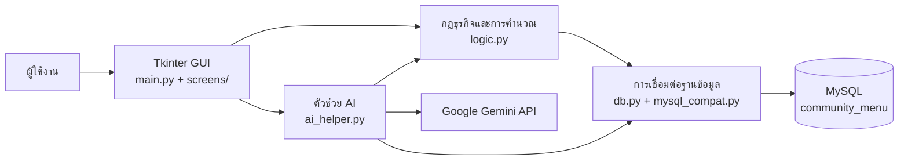

# Community Menu Planner

ระบบเดสก์ท็อปสำหรับวางแผนเมนูอาหาร คำนวณวัตถุดิบ จัดการสต็อกแบบแยกล็อต และสร้างคำสั่งซื้อจากเกษตรกรในชุมชน โดยใช้ AI เป็นผู้ช่วยเสนอเมนูเท่านั้น การคำนวณปริมาณ ต้นทุน สต็อก และการบันทึกข้อมูลทั้งหมดทำโดยโค้ดของระบบและ MySQL

เอกสารชุดนี้อ้างอิงโค้ดปัจจุบันใน repository นี้ แบ่งเป็น 3 ไฟล์หลัก:

1. `README.md` — ภาพรวมระบบ สถาปัตยกรรม และวิธีติดตั้ง
2. `CODE_GUIDE.md` — อธิบายโค้ดและลำดับการทำงานอย่างละเอียด
3. `DATABASE_GUIDE.md` — อธิบาย SQL ตาราง ความสัมพันธ์ และ ER Diagram

## 1. เป้าหมายของระบบ

ระบบช่วยแก้ปัญหาหลักของร้านอาหารหรือครัวชุมชนดังนี้

- รู้ว่าวัตถุดิบแต่ละชนิดเหลือเท่าไร และอยู่ในล็อตใด
- เลือกใช้ล็อตที่ควรใช้ก่อนเร็วที่สุดก่อน เพื่อลดของเสีย
- คำนวณจากสูตรต่อจานว่าหลายเมนูต้องใช้วัตถุดิบรวมเท่าไร
- เปรียบเทียบความต้องการกับสต็อกที่ยังใช้ได้ แล้วหาปริมาณที่ต้องซื้อเพิ่ม
- เลือกข้อเสนอจากเกษตรกรที่พร้อมส่งและมีราคาต่อหน่วยมาตรฐานต่ำที่สุด
- สร้างแผนเมนู ใบสั่งซื้อ รับสินค้า และเบิกวัตถุดิบอย่างมีประวัติย้อนหลัง
- สรุปยอดซื้อจากชุมชน มูลค่าการเบิกใช้ และมูลค่าของเสีย
- ใช้ Google Gemini ช่วยเสนอเมนู แต่ไม่อนุญาตให้ AI แก้ฐานข้อมูลหรือเป็นผู้คำนวณตัวเลขหลัก

## 2. ผู้ใช้และขอบเขต

โปรแกรมปัจจุบันเหมาะกับการสาธิตหรือใช้งานภายในร้านขนาดเล็กบนเครื่อง Windows เครื่องเดียว ผู้ใช้งานหลักคือผู้ดูแลคลัง ผู้วางแผนเมนู และผู้รับสินค้า ระบบยังไม่มีบัญชีผู้ใช้ การกำหนดสิทธิ์ การทำงานหลายสาขา หรือ API สำหรับระบบภายนอก

ข้อมูลตัวอย่างที่ระบบสร้างครั้งแรกเป็นข้อมูลจำลอง ไม่ใช่ข้อมูลจริงของร้านหรือเกษตรกร

## 3. ภาพรวมสถาปัตยกรรม



หน้าที่ของแต่ละชั้นมีดังนี้

| ชั้น | ไฟล์ | หน้าที่ |
|---|---|---|
| หน้าจอ | `main.py`, `screens/*.py` | รับข้อมูล แสดงตาราง เปิดกล่องยืนยัน และเรียกใช้กฎธุรกิจ |
| กฎธุรกิจ | `logic.py` | ตรวจข้อมูล แปลงหน่วย คำนวณแผน ตัดล็อต สร้างคำสั่งซื้อ และทำรายงาน |
| AI | `ai_helper.py` | สรุปข้อมูลที่จำเป็น ส่งให้ Gemini ตรวจคำตอบ และคืนเฉพาะเมนูที่มีจริง |
| ฐานข้อมูล | `db.py` | อ่านค่าการเชื่อมต่อ สร้างตาราง และสร้างข้อมูลสาธิตเมื่อฐานข้อมูลว่าง |
| ตัวเข้ากันได้ | `mysql_compat.py` | แปลง placeholder จาก `?`/`:name` เป็นรูปแบบ MySQL และทำให้ผลลัพธ์เข้าถึงแบบ dictionary ได้ |
| การจัดเก็บ | MySQL | เก็บวัตถุดิบ ล็อต การเคลื่อนไหว สูตร เกษตรกร แผน และคำสั่งซื้อ |

หลักสำคัญคือหน้าจอไม่ควรแก้ตารางโดยตรง งานที่กระทบข้อมูลต้องผ่าน `logic.py` เพื่อให้การตรวจสอบและ transaction ทำงานเหมือนกันทุกหน้าจอ

## 4. หน้าจอทั้ง 7 แท็บ

| แท็บ | งานที่ทำได้ |
|---|---|
| หน้าหลัก | ดูวัตถุดิบต่ำกว่าขั้นต่ำ ล็อตใกล้ถึงวันควรใช้ก่อน คำสั่งซื้อรอรับ และยอดซื้อ 30 วันล่าสุด |
| คลังวัตถุดิบ | ค้นหา เพิ่ม/แก้วัตถุดิบ รับเข้า เบิกใช้ บันทึกของเสีย ปรับยอด ดูล็อตและประวัติ |
| สูตรอาหาร | เพิ่มหรือแก้เมนู และกำหนดวัตถุดิบต่อ 1 จาน |
| ข้อมูลชุมชน | เก็บข้อมูลเกษตรกรและผลผลิตพร้อมขาย ราคา หน่วยขาย จำนวน และวันที่พร้อมส่ง |
| แผนเมนูและ AI | ให้ AI เสนอเมนูหรือเลือกเอง คำนวณวัตถุดิบ ต้นทุน ซื้อเพิ่ม ยืนยันแผน และเบิกตามแผน |
| การจัดซื้อ | สร้างคำสั่งซื้อเอง ดูรายการ รับสินค้าเป็นล็อตใหม่ หรือยกเลิกคำสั่งซื้อ |
| รายงาน | ดูมูลค่าซื้อจากเกษตรกร การเบิกใช้ และของเสียในช่วงวันที่ |

เมื่อผู้ใช้เปลี่ยนแท็บ โปรแกรมเรียก `refresh()` ของแท็บนั้นเพื่ออ่านข้อมูลล่าสุดจาก MySQL

## 5. กระบวนการทำงานหลัก

### 5.1 ตั้งค่าข้อมูลพื้นฐาน

1. เพิ่มวัตถุดิบและกำหนดหน่วยมาตรฐานเป็น `กรัม`, `ฟอง` หรือ `ชิ้น`
2. เพิ่มสูตรอาหาร โดยระบุปริมาณต่อ 1 จานด้วยหน่วยมาตรฐาน
3. เพิ่มเกษตรกรและผลผลิตพร้อมขาย
4. รับวัตถุดิบเริ่มต้นเข้าคลัง หรือใช้ข้อมูลสาธิตที่ระบบสร้างให้

### 5.2 วางแผนเมนู

1. เลือกเมนูและจำนวนจาน หรือให้ AI เสนอเมนู
2. ระบบรวมวัตถุดิบชนิดเดียวกันจากทุกเมนู
3. ระบบนับเฉพาะล็อตที่ยังไม่เลยวัน `use_by` เป็นสต็อกที่ใช้วางแผนได้
4. คำนวณ `ซื้อเพิ่ม = max(0, ต้องใช้ - สต็อกที่ใช้ได้)`
5. คำนวณต้นทุนของจากคลังตามลำดับล็อต และต้นทุนซื้อเพิ่มจากข้อเสนอที่ถูกที่สุดซึ่งพร้อมส่งแล้ว
6. แสดงปัญหา เช่น ไม่มีผู้ขาย ผู้ขายมีไม่พอ หรือยอดซื้อเกินงบ
7. เมื่อยืนยัน ระบบบันทึกแผนและแยกคำสั่งซื้อตามเกษตรกร

คำเตือนเรื่องเกินงบเป็นข้อมูลช่วยตัดสินใจ เวอร์ชันปัจจุบันยังอนุญาตให้ผู้ใช้ยืนยันแผนหลังอ่านข้อความยืนยันได้

### 5.3 รับสินค้าและเบิกตามแผน

1. คำสั่งซื้อเริ่มที่สถานะ `PENDING`
2. เมื่อกดรับสินค้า ระบบสร้างล็อตใหม่ สร้าง movement แบบ `IN` ลดจำนวนผลผลิตพร้อมขาย และเปลี่ยนคำสั่งซื้อเป็น `RECEIVED`
3. เมื่อกดเบิกตามแผน ระบบตัดล็อตตามวันที่ควรใช้ก่อนและสร้าง movement แบบ `USE`
4. ถ้าวัตถุดิบรายการใดไม่พอ การเบิกทั้งแผนจะ rollback และไม่มีรายการใดถูกตัดค้างครึ่งทาง

## 6. โครงสร้างไฟล์

```text
CommunityMenu/
├─ main.py                    จุดเริ่มโปรแกรมและหน้าต่างหลัก
├─ db.py                      การเชื่อมต่อ สคีมา และข้อมูลสาธิต
├─ mysql_compat.py            ตัวแปลงคำสั่ง/ผลลัพธ์ให้เข้ากับ MySQL
├─ logic.py                   กฎธุรกิจและการคำนวณทั้งหมด
├─ ai_helper.py               การเรียก Gemini และตรวจคำตอบ
├─ screens/                   หน้าจอทั้ง 7 แท็บและ widget ที่ใช้ร่วมกัน
├─ test_logic.py              integration tests สำหรับฐานข้อมูลทดสอบ
├─ config.ini                 ค่าการเชื่อมต่อ MySQL สำหรับเครื่องนี้
├─ requirements.txt           Python packages
├─ setup_database.sql         สร้าง database และผู้ใช้สำหรับติดตั้งปกติ
├─ community_menu_mysql.sql   full export/snapshot สำหรับอ้างอิงหรือย้ายข้อมูล
├─ INSTALL.bat                สร้าง virtual environment และติดตั้ง package
├─ RUN_APP.bat                เปิดโปรแกรมด้วย virtual environment
├─ README.md                  ภาพรวมและวิธีติดตั้ง
├─ CODE_GUIDE.md              คู่มือโค้ด
└─ DATABASE_GUIDE.md          คู่มือฐานข้อมูลและ ER Diagram
```

## 7. สิ่งที่ต้องติดตั้งก่อน

- Windows ที่สามารถรันไฟล์ `.bat` ได้
- Python 3 พร้อม Tkinter และ Python Launcher (`py`)
- MySQL Server ที่กำลังทำงานอยู่; MySQL Workbench อย่างเดียวไม่ใช่ตัว server
- อินเทอร์เน็ตในครั้งแรกที่ติดตั้ง package
- อินเทอร์เน็ตและ Gemini API key เฉพาะเมื่อต้องการใช้ปุ่ม AI

Python packages ที่ใช้มี `mysql-connector-python` และ `google-genai` ตาม `requirements.txt` ส่วน Tkinter มากับ Python สำหรับ Windows โดยทั่วไป

## 8. วิธีติดตั้งบน Windows

### 8.1 ดาวน์โหลดโครงการ

ดาวน์โหลด ZIP จาก GitHub แล้วแตกไฟล์ หรือ clone repository:

```powershell
git clone <repository-url>
cd CommunityMenu
```

อย่ารันโปรแกรมจากภายใน ZIP และไม่ควรนำไฟล์ไปทับโฟลเดอร์เวอร์ชันเก่าที่มีการตั้งค่าคนละชุด

### 8.2 ติดตั้ง Python packages

วิธีง่ายที่สุดคือดับเบิลคลิก `INSTALL.bat` สคริปต์จะสร้าง `.venv` และติดตั้ง package จาก `requirements.txt`

หรือทำผ่าน PowerShell:

```powershell
py -m venv .venv
.\.venv\Scripts\python.exe -m pip install -r requirements.txt
```

### 8.3 สร้างฐานข้อมูลและผู้ใช้

1. เปิด MySQL Workbench และเชื่อมต่อด้วยบัญชีผู้ดูแล เช่น `root`
2. เปิดไฟล์ `setup_database.sql`
3. เลือกคำสั่งทั้งหมดและกด Execute หนึ่งครั้ง

ไฟล์นี้สร้างค่าตัวอย่างดังนี้

| ค่า | ค่าเริ่มต้น |
|---|---|
| Host | `localhost` |
| Port | `3306` |
| Database | `community_menu` |
| User | `menu_user` |
| Password | `your_password` |

รหัสผ่านนี้เหมาะกับการเรียนหรือสาธิตในเครื่องเท่านั้น หากใช้งานจริงควรเปลี่ยนรหัสผ่านทั้งใน MySQL และ `config.ini`

ไม่ต้อง import `community_menu_mysql.sql` สำหรับการติดตั้งปกติ เมื่อเปิดโปรแกรมครั้งแรก `db.py` จะสร้างตารางและข้อมูลสาธิตเองหากตาราง `ingredients` ยังว่าง

### 8.4 ตั้งค่าการเชื่อมต่อ

แก้ `config.ini` หาก MySQL ของเครื่องใช้ค่าอื่น:

```ini
[mysql]
host = localhost
port = 3306
user = menu_user
password = your_password
database = community_menu
```

สามารถใช้ environment variables แทนได้ และ environment variables มีลำดับความสำคัญสูงกว่า `config.ini`:

- `DB_HOST`
- `DB_PORT`
- `DB_USER`
- `DB_PASSWORD`
- `DB_NAME`

ตัวอย่างสำหรับ PowerShell session ปัจจุบัน:

```powershell
$env:DB_HOST = "localhost"
$env:DB_PORT = "3306"
$env:DB_USER = "menu_user"
$env:DB_PASSWORD = "your_password"
$env:DB_NAME = "community_menu"
```

### 8.5 ตั้งค่า AI แบบไม่บังคับ

ส่วนอื่นของระบบทำงานได้โดยไม่มี AI หากต้องการใช้ Gemini ให้สร้าง API key ของตนเองแล้วตั้งค่าใน PowerShell ก่อนเปิดโปรแกรม:

```powershell
$env:GEMINI_API_KEY = "ใส่คีย์ของคุณที่นี่"
.\.venv\Scripts\python.exe main.py
```

อย่า commit API key ลง GitHub และอย่าใส่คีย์จริงในเอกสาร รูปหน้าจอ หรือไฟล์ที่ส่งต่อ

### 8.6 เปิดโปรแกรม

ดับเบิลคลิก `RUN_APP.bat` หรือรัน:

```powershell
.\.venv\Scripts\python.exe main.py
```

ลำดับการเริ่มทำงานคือเชื่อมต่อ MySQL ลบ trigger เก่าที่อาจปรับสต็อกซ้ำ สร้างตารางที่ยังไม่มี เติมข้อมูลสาธิตเมื่อฐานข้อมูลว่าง แล้วจึงเปิดหน้าต่าง Tkinter

## 9. ตรวจสอบหลังติดตั้ง

เมื่อเปิดสำเร็จควรเห็นแท็บ 7 แท็บ และข้อมูลสาธิตอย่างน้อย:

- วัตถุดิบ 20 รายการ
- เมนู 10 รายการ
- เกษตรกร 5 ราย
- ผลผลิตพร้อมขายและล็อตเริ่มต้น

ลองทดสอบตามลำดับนี้:

1. เปิดแท็บคลังวัตถุดิบ เลือกวัตถุดิบ และดูล็อตกับประวัติ
2. เปิดแท็บแผนเมนู เลือกเมนู กรอกจำนวนจาน และตรวจผลคำนวณ
3. ยืนยันแผน แล้วเปิดแท็บการจัดซื้อเพื่อตรวจคำสั่งซื้อ
4. รับสินค้าและกลับไปดูว่ามีล็อตใหม่กับ movement แบบ `IN`
5. เบิกตามแผนและตรวจ movement แบบ `USE`
6. เปิดรายงานและเลือกช่วงวันที่ที่ครอบคลุมรายการทดสอบ

## 10. การสำรองและกู้คืน

สำรองด้วย `mysqldump`:

```powershell
mysqldump -u menu_user -p --databases community_menu > community_menu_backup.sql
```

กู้คืนลงฐานข้อมูลที่เตรียมไว้:

```powershell
mysql -u menu_user -p community_menu < community_menu_backup.sql
```

ควรปิดโปรแกรมระหว่างกู้คืน และสำรองไฟล์เดิมก่อนทุกครั้ง ห้าม import full export ซ้ำทับฐานข้อมูลที่มีข้อมูลอยู่ เพราะอาจชน Primary Key หรือทำให้ข้อมูลซ้ำ

## 11. การรันทดสอบสำหรับนักพัฒนา

`test_logic.py` จะลบและสร้างตารางใหม่ จึงอนุญาตให้ทำงานเฉพาะฐานข้อมูลที่ชื่อขึ้นต้นด้วย `community_menu_test_` เท่านั้น ห้ามชี้ test ไปที่ฐานข้อมูลจริง

ตัวอย่าง:

```sql
CREATE DATABASE community_menu_test_demo CHARACTER SET utf8mb4 COLLATE utf8mb4_unicode_ci;
GRANT ALL PRIVILEGES ON community_menu_test_demo.* TO 'menu_user'@'localhost';
```

จากนั้นรันใน PowerShell:

```powershell
$env:DB_NAME = "community_menu_test_demo"
.\.venv\Scripts\python.exe -m unittest -v test_logic
Remove-Item Env:DB_NAME
```

## 12. ปัญหาที่พบบ่อย

| อาการ | สาเหตุที่พบบ่อย | วิธีตรวจ |
|---|---|---|
| `Access denied` | user/password ไม่ตรง | รัน `setup_database.sql` ด้วยผู้ดูแล และตรวจ `config.ini`/environment variables |
| `Can't connect` | MySQL Server ไม่ทำงาน หรือ host/port ผิด | เปิด service ของ MySQL และตรวจ port |
| `Unknown database` | ยังไม่ได้สร้าง `community_menu` | รัน `setup_database.sql` |
| ดับเบิลคลิกแล้วหน้าต่างดำหาย | Python หรือ package มีปัญหา | เปิดด้วย `RUN_APP.bat` เพื่อให้ข้อความ error ค้าง |
| `Python launcher not found` | ไม่มีคำสั่ง `py` | ติดตั้ง Python พร้อม launcher และ Tcl/Tk |
| ตัวเลขสต็อกผิดเป็นสองเท่า | เคยใช้ trigger เก่าที่แก้ล็อตซ้ำ | โค้ดปัจจุบันลบ trigger ตอนเริ่ม แต่ยอดเก่าต้องตรวจและปรับพร้อมเหตุผล |
| AI ใช้ไม่ได้ | ไม่มี key, ไม่มีเน็ต, package ไม่ครบ หรือโควตาหมด | ตั้ง `GEMINI_API_KEY`; ผู้ใช้ยังเลือกเมนูเองได้ |
| เมนูขึ้นว่าไม่มีผู้ขาย | ไม่มีผลผลิตที่พร้อมส่งวันนี้และมีจำนวนมากกว่า 0 | ตรวจ `ready_date`, `qty_available` และหน่วยขาย |

## 13. ข้อจำกัดที่ควรรู้

- วันที่ `use_by` เป็นตัวช่วยจัดลำดับและเตือน ผู้ใช้ต้องตรวจสภาพอาหารจริง
- ล็อตหมดอายุยังแสดงเป็นของที่มีอยู่จริงบางหน้าจอ แต่จะไม่ถูกนับเป็นสต็อกที่ใช้วางแผนหรือเบิกแบบ `USE`
- ระบบเลือกข้อเสนอที่ราคาต่อหน่วยมาตรฐานต่ำที่สุดเพียงรายเดียวต่อวัตถุดิบ ยังไม่แบ่งซื้อหลายผู้ขายเมื่อรายเดียวมีไม่พอ
- การเกินงบแสดงเป็นคำเตือน ไม่ใช่เงื่อนไขบล็อกการยืนยัน
- ระบบยังไม่ได้ออกแบบสำหรับผู้ใช้หลายคนแก้สต็อกพร้อมกัน
- `community_menu_mysql.sql` เป็น snapshot แบบเต็ม ส่วนสคีมาที่โปรแกรมใช้จริงอยู่ใน `DDL_STATEMENTS` ของ `db.py`

รายละเอียดเชิงโค้ดอ่านต่อที่ [CODE_GUIDE.md](CODE_GUIDE.md) และรายละเอียดตาราง/ความสัมพันธ์อ่านที่ [DATABASE_GUIDE.md](DATABASE_GUIDE.md)
